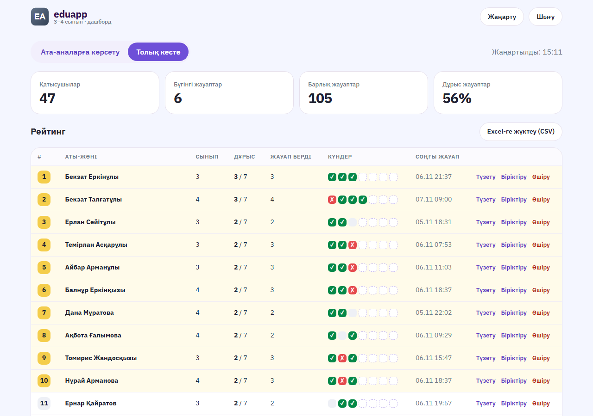

# Online Olympiad Platform — "Problem of the Day"

A lightweight serverless web app that prepares primary-school children for math olympiads: parents open the site, see today's problem (Kazakh / Russian), and submit their child's answer; the organiser gets a password-protected dashboard with a live leaderboard and a one-click PNG "leaders" board to share with parents.



## Features

- **One codebase, two sites.** The same code serves grades 3–4 and grades 5–6 (`GROUP=34` / `GROUP=56`), each with its own database and dashboard.
- **One problem per day.** A problem is open only on its own day (00:00–23:59, Asia/Almaty). Answers are never sent to the browser, and future problems stay hidden.
- **No sign-up for parents.** A child is identified by first and last name. Matching ignores case, word order and Kazakh vs Russian spelling (`Әли Серік` = `али серик` = `Серик Али`). The name and grade are filled in automatically the next day.
- **Forgiving answer parsing.** `1 275`, `1,275`, `75°` and `5000 тг` are all read as a single number. Inputs such as `57 or 58` are rejected.
- **Exactly one answer per child per problem**, even under concurrent double-clicks. It is enforced in one SQL statement (`INSERT … ON CONFLICT` in a CTE), and the client retries automatically after network errors.
- **Admin dashboard (`/admin`):**
  - Leaderboard: ties are broken by the earlier last correct answer.
  - Per-day ✓/✗ grid and an answer-distribution chart.
  - CSV export.
  - "⚠ similar name" detection, with **Merge** and **Edit** actions to fix duplicate children.
  - A PNG "leaders" card for sharing in a parents' chat.
- **Load-tested.** `tests/load.mjs` simulates N parents submitting at once. The original deployment handled 1000 parallel submissions with no errors and no duplicate rows.

## Tech stack

- **Runtime:** Node.js 18+ (ES modules). Vercel serverless functions run in production (`api/*.js`), and a zero-dependency local dev server stands in for them.
- **Database:**
  - Production: PostgreSQL (Neon serverless driver).
  - Demo: [PGlite](https://pglite.dev) (in-memory Postgres compiled to WASM). The production SQL runs unchanged.
- **Frontend:** vanilla HTML, CSS and JS; no build step. `html2canvas` generates the PNG export.
- **Tests:** `node:test` unit tests, end-to-end scenario tests against a real database, and a load-test script.

## Project structure

```
api/
  today.js          GET today's problem (+ "already answered?" for a given name)
  submit.js         validate + save an answer (single SQL round-trip)
  admin.js          password-protected dashboard API: data, merge, edit, delete
  _lib/problems.js  problem bank, schedule, Almaty-time logic, answer parsing
  _lib/db.js        Postgres access (Neon or PGlite demo), name normalisation, schema, demo seeding
public/
  index.html, app.js, app.css, base.css   parent-facing page (KK/RU)
  admin.html                              dashboard (leaderboard, stats, PNG/CSV export)
scripts/generate-demo-data.mjs            random demo participants & answers → demo/demo-data.json
demo/demo-data.json                       generated demo data (committed, used in DEMO mode)
tests/unit.test.mjs                       pure logic tests
tests/scenarios.mjs                       end-to-end API scenarios (real DB or demo PGlite)
tests/load.mjs                            load test against a running site
dev-server.mjs                            local server: public/ + api/ without Vercel
deploy.sh, vercel.json                    deployment of both sites to Vercel
```

## How to run (demo mode)

The demo needs no keys and no database. When there is no `.env.34` / `.env.56` file, `dev-server.mjs` switches to **DEMO mode**: it starts an in-memory Postgres (PGlite) and seeds it from `demo/demo-data.json`. The schedule shifts so that day 4 is open today and days 1–3 already have results.

```bash
npm install
node dev-server.mjs 34        # grades 3–4 → http://localhost:4334
node dev-server.mjs 56        # grades 5–6 → http://localhost:4356
```

- Parent page: `http://localhost:4334/`
- Dashboard: `http://localhost:4334/admin`. The local demo password is `local-test-123`.
- Data lives in memory only, so a restart resets it to the generated demo set.

Tests:

```bash
npm test                                                               # unit tests
DEMO_MODE=1 GROUP=34 ADMIN_PASSWORD=local-test-123 node tests/scenarios.mjs   # 9 API scenarios on PGlite
node scripts/generate-demo-data.mjs [seed]                             # regenerate the demo data
```

For a real deployment, copy `.env.example` to `.env.34` / `.env.56` and fill in `OLYMP_DATABASE_URL` and `ADMIN_PASSWORD`. Then run `bash deploy.sh`. It deploys two Vercel projects; set the project names inside the script.

> All data in this repository is randomly generated; brand names are anonymized.

## Кратко (RU)

Сайт «Задача дня» для подготовки к олимпиаде. Родитель каждый день видит одну задачу и отправляет ответ ребёнка. Администратор в дашборде с паролем видит рейтинг, статистику и PNG-картинку для родителей.
Один код обслуживает два сайта (3–4 и 5–6 классы), ребёнок определяется по ФИО, на одну задачу принимается только один ответ.
Демо: `npm install`, затем `node dev-server.mjs 34` → http://localhost:4334 (дашборд: `/admin`, пароль `local-test-123`).
Все данные сгенерированы случайно, названия брендов изменены.
